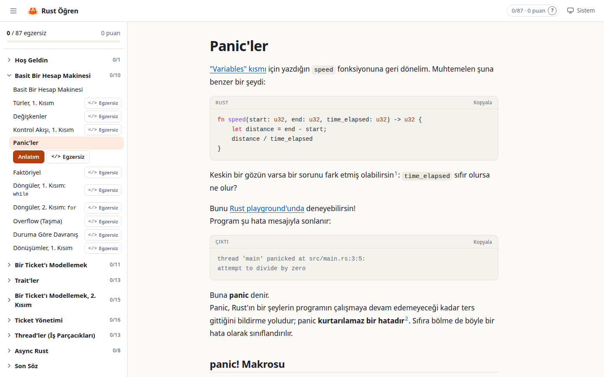
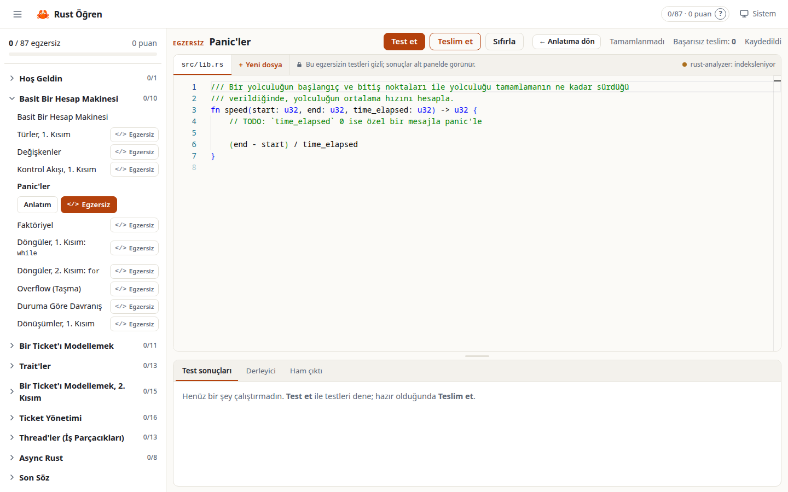

# Rust Öğren

**Rust'ı Türkçe, alıştırma alıştırma öğren — tarayıcında, kurulumla uğraşmadan.**

Bu proje, Mainmatter'ın [100 Exercises To Learn Rust](https://github.com/mainmatter/100-exercises-to-learn-rust)
kursunun Türkçe ve etkileşimli bir sürümüdür. Her konunun Türkçe anlatımını okursun, ardından
aynı konunun egzersizini tarayıcıdaki küçük bir Rust IDE'sinde çözer, test eder ve teslim edersin.



> [!NOTE]
> Kursun aslı [Mainmatter](https://mainmatter.com/rust-consulting/) tarafından yazılmıştır
> ([rust-exercises.com](https://rust-exercises.com)). Bu repo, orijinal projenin bir fork'udur;
> anlatımlar ve egzersiz yorumları Türkçeye çevrilmiş, üzerine bir öğrenme uygulaması eklenmiştir.
> Orijinal İngilizce README: [README.en.md](README.en.md).

## Özellikler

- **Kitabın tamamı Türkçe:** 9 bölüm, 99 sayfa ve egzersizlerdeki bütün yorumlar. Rust
  terimleri tutarlı bir [sözlüğe](tr/glossary.json) göre çevrildi; yerleşik İngilizce terimler
  (trait, struct, ownership…) korunup ilk geçişte Türkçe açıklamayla verilir.
- **Tarayıcıda IDE:** Monaco editörü ve rust-analyzer ile tür bilgisi, otomatik tamamlama ve
  anlık hata gösterimi. Derleyici hataları ilgili satırda işaretlenir.
- **Test et / Teslim et:** "Test et" serbesttir; "Teslim et" puana işlenir.
- **Gizli testler:** Test kodu çözüm ipucu vermesin diye editörde gösterilmez; sonuçlar alt
  panelde görünür.
- **İlerleme:** Bölüm bölüm ilerleme, puanlar ve "kaldığın yerden devam et". İlerleme yerelde
  SQLite'ta saklanır.
- **Çevrimdışı çalışır:** Docker imajında Rust araç zinciri, rust-analyzer ve egzersizlerin
  bağımlılıkları hazırdır.



## Hızlı başlangıç (Docker)

Gereken tek şey [Docker](https://docs.docker.com/get-docker/) (Compose dahil).

```bash
git clone https://github.com/BurakErguvn/rust-ogren.git
cd rust-ogren
docker compose up --build
```

Ardından tarayıcında **http://localhost:3000** adresini aç. İlk derleme birkaç dakika sürebilir.

- Durdurmak için: `Ctrl+C` ya da `docker compose down`.
- Arka planda çalıştırmak için: `docker compose up -d`.
- Kodun ve ilerlemen Docker volume'larında saklanır, yeniden başlatınca kaldığın yerden devam
  edersin. Her şeyi sıfırlamak için: `docker compose down -v`.

## Docker olmadan çalıştırma

Gerekenler:

- Güncel kararlı [Rust](https://www.rust-lang.org/tools/install) ve rust-analyzer bileşeni:
  `rustup component add rust-analyzer rust-src`
- Arayüzü derlemek için [Node.js](https://nodejs.org/) 22 (yalnızca derleme sırasında gerekir)

```bash
cd app/web && npm ci && npm run build && cd ../..
cargo run --release -p server
```

Sunucu **http://127.0.0.1:3000** adresinde açılır.

## Puanlama

- Yalnızca **Teslim et** puana işlenir: `puan = max(100 − 10 × başarısız teslim, 50)`.
- **Test et** serbesttir ve puanı etkilemez.
- Derleme hatası ve zaman aşımı da başarısız teslim sayılır.
- Egzersizi tamamladığın anda puanın sabitlenir; **Sıfırla** yalnızca kodu başa döndürür.

## Ayarlar

Sunucu ortam değişkenleriyle ayarlanır:

| Değişken | Varsayılan | Açıklama |
|---|---|---|
| `PORT` | `3000` | Dinlenen port |
| `HOST` | `127.0.0.1` (Docker'da `0.0.0.0`) | Dinlenen adres |
| `RUST_LEARN_ROOT` | repo kökü | Kitap, egzersiz ve çevirilerin bulunduğu dizin |
| `WEB_DIST` | `app/web/out` | Derlenmiş arayüz |
| `WORKSPACE_DIR` | `app/workspace` | Egzersizlerin çalışma kopyaları |
| `DATA_DIR` | `app/data` | İlerleme veritabanı (`progress.db`) |
| `COMPILE_TIMEOUT_SECS` | `120` | Derleme zaman aşımı |
| `TEST_TIMEOUT_SECS` | `15` | Test zaman aşımı |
| `RUST_ANALYZER` | `PATH`'teki `rust-analyzer` | rust-analyzer'ın yolu |

> [!WARNING]
> Uygulama, editöre yazılan kodu derleyip çalıştırır ve bunu bir sandbox içinde yapmaz.
> Tek kullanıcılı, yerel kullanım için tasarlandı; sunucuyu internete açma. Docker Compose
> portu bu yüzden yalnızca `127.0.0.1` üzerinden yayımlar.

## Mimari

```text
book/, exercises/, helpers/   orijinal kurs (değiştirilmez; upstream'den güncellenebilir)
tr/
  book/                       Türkçe sayfalar (book/src ile aynı yollar)
  exercises/                  Türkçe yorumlu .rs dosyaları (exercises/ ile aynı yollar)
  notes/                      uygulamaya özel sayfa notları
  glossary.json, STYLE.md     terim sözlüğü ve çeviri stil rehberi
  removed-exercises.json      uygulamada gösterilmeyen egzersizler
app/
  server/                     axum sunucusu: içerik API'si, test çalıştırıcı, puanlama, LSP köprüsü
  web/                        Next.js arayüzü (statik çıktı, sunucu tarafından servis edilir)
  tools/tr-check/             çeviri doğrulama aracı
  API.md                      sunucu ↔ arayüz API sözleşmesi
```

- Tek süreç, tek port: axum sunucusu hem API'yi hem de derlenmiş arayüzü sunar.
- Bir egzersiz ilk açıldığında `app/workspace/` altında kendi Cargo workspace'i içinde bir
  çalışma kopyası oluşturulur: orijinal crate kopyalanır, üzerine `tr/exercises/` altındaki
  Türkçe dosyalar yazılır. `helpers/` yolları ve kök `Cargo.toml`'daki profil ayarları aynen
  çalışır. Testler bu kopyada `cargo test` ile, zaman aşımıyla çalıştırılır.
- rust-analyzer, egzersiz başına bir süreç olarak WebSocket üzerinden editöre bağlanır.
- Türkçe dosyası olmayan bir sayfa ya da egzersiz için İngilizce orijinal gösterilir.

## Çeviriye katkı

Bir çeviri hatası ya da daha iyi bir ifade önerin varsa issue açabilirsin. Çeviri dosyalarını
düzenlerken:

- [tr/STYLE.md](tr/STYLE.md) ve [tr/glossary.json](tr/glossary.json) bağlayıcıdır.
- Egzersizlerde yalnızca yorumlar çevrilir; kod, string'ler ve test mesajları aynen kalır.
- Değişiklikten sonra doğrulama aracını çalıştır, hata vermemeli:

```bash
cargo run -q -p tr-check
```

## Geliştirme

```bash
cargo test -p server -p tr-check
cargo clippy -p server -p tr-check --all-targets -- -D warnings
cd app/web && npm run lint && npm run build
```

Arayüzü geliştirirken `cd app/web && npm run dev` (port 3001) API isteklerini
`localhost:3000`'deki sunucuya yönlendirir.

## Lisans

Bu repodaki her şey — orijinal kurs, Türkçe çeviri ve uygulama — **ticari olmayan kullanım**
için [PolyForm Noncommercial 1.0.0](https://polyformproject.org/licenses/noncommercial/1.0.0)
lisansıyla yayımlanır. Ayrıntılar: [LICENSE](LICENSE).

- Orijinal kurs: Copyright © 2024- Mainmatter GmbH (https://mainmatter.com)
- Türkçe çeviri ve uygulama: Copyright © 2026- [BurakErguvn](https://github.com/BurakErguvn)

Kursu bir şirket içinde kullanmayı düşünüyorsan lisans için
[Mainmatter ile iletişime geç](mailto:training@mainmatter.com). Mainmatter bu kursu
[eğitmen eşliğinde bir atölye](https://mainmatter.com/training/learn-rust-starting-from-scratch/)
olarak da sunuyor.
